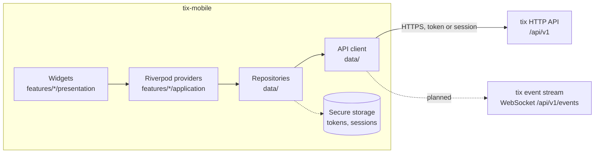

<!-- markdownlint-disable MD013 -->
<p align="center">
  <picture>
    <source media="(prefers-color-scheme: dark)" srcset="assets/branding/logo-dark.svg">
    
  </picture>
</p>

<p align="center">
  The <a href="https://github.com/heliopsy/tix">tix</a> client for Android, iOS, Linux, macOS and Windows.<br>
  Your tasks from a tix server, in one Flutter app.
</p>

<!-- Badge markup and link tables are naturally long; wrapping them helps nobody. -->
<table align="center">
  <tr>
    <th>CI</th>
    <th>Code</th>
    <th>Security</th>
  </tr>
  <tr>
    <td>
      <a href="https://github.com/heliopsy/tix-mobile/actions/workflows/ci.yaml"></a><br>
      <a href="https://github.com/heliopsy/tix-mobile/actions/workflows/release.yaml"></a><br>
      <a href="https://github.com/heliopsy/tix-mobile/actions/workflows/codeql.yaml"></a>
    </td>
    <td>
      <a href="https://github.com/heliopsy/tix-mobile/releases/latest"></a><br>
      <a href="https://codecov.io/gh/heliopsy/tix-mobile"></a><br>
      <a href=".tool-versions"></a><br>
      <a href=".tool-versions"></a>
    </td>
    <td>
      <a href="https://scorecard.dev/viewer/?uri=github.com/heliopsy/tix-mobile"></a><br>
      <a href="SECURITY.md"></a><br>
      <a href="LICENSE"></a><br>
      <a href="CLA.md"></a>
    </td>
  </tr>
</table>
<!-- markdownlint-enable MD013 -->

tix is task management for humans and AI agents: a server with a CLI, a terminal board, an HTTP API, a WebSocket
event stream and a web UI. tix-mobile is a native client for that server. It talks to the same `/api/v1` the CLI
uses when you point it at a server, so a task an agent claims from a terminal is the task you read on your phone a
second later.

> **Status: early, pre-release.** The first slice below is what is being built now. Nothing has been released yet,
> the app has not been run by anyone but its author, and it covers a small part of what the tix API offers.
> Expect rough edges and breaking changes until 1.0. [ROADMAP.md](ROADMAP.md) says what comes next.

## How it fits with tix

```text
tix serve ── /api/v1 (JSON, keyset paginated) ── tix-mobile
    │
    ├── tix CLI, tix TUI, web UI, tix mcp      the same service, other ways in
    └── agents claiming work with leases
```

tix-mobile keeps no data of its own beyond the servers you added and a few preferences. The server is the source of
truth, its rules apply unchanged, and the token you give the app limits what it can see and do, exactly as it would
for the CLI.

## Platforms

| Platform | Minimum | Release artifact | Token stored in |
| --- | --- | --- | --- |
| Android | 7.0, API 24 (Flutter's default `minSdk`) | APK per ABI, AAB | Android Keystore |
| iOS | 15.0 | None yet, build from source | Keychain |
| macOS | 12.0 | `.zip` | Keychain |
| Linux | x64 and arm64 desktop with GTK 3 | `.tar.gz` | libsecret (GNOME Keyring, KWallet) |
| Windows | Windows 10, x64 | `.zip` | DPAPI |

Every platform carries the embedded tix engine for local databases, which makes each artifact roughly 30 MB
larger than the client alone. iOS builds are not published until signing is set up. Store listings (Google Play,
App Store, F-Droid, Flathub) are on the [roadmap](ROADMAP.md), not available today.

## Features

- **Several tix servers**, each with one or more connections: an API token, or a sign-in with email and password
  (second factor included). A sign-in can follow you between your tenants on that server or stay pinned to one.
- **Invite links**: paste one, or share it to tix, see what it admits you to, accept it, and the server and the
  sign-in are added for you.
- **Token rotation** for a token connection: one tap swaps its API token for a new one and keeps only the new value.
- **A switcher on every screen** showing Instance › Tenant, recent ones first.
- **Connection details** behind the live status: why updates are live, polling or offline, the last error with
  what it may mean (a proxy timing out idle connections, one that drops WebSocket upgrades, a certificate), the
  recent history, Reconnect now and a redacted report to copy.
- **Local databases** on every platform: tix itself is built into the app and serves a `.db` file on this device,
  with no server anywhere. Android, iOS and macOS import a copy into the app and export it back through the share
  sheet or a save dialog. An advanced choice opens a database in place on every platform, for example in a folder
  Nextcloud, Syncthing or iCloud Drive syncs (Android needs "All files access" for it, and a Google Play build can
  leave that out). The engine runs only for the active local instance, stops after 10 minutes without a request
  (a setting) and starts again on the next one. It costs about 32 MB per Android ABI and 34 MB on desktop.
- **Projects** visible to the active connection, each in its colour with its open task count, and a switcher in
  the project's title. Create one, change its name, key, description, colour, icon, workflow and lease bounds,
  archive it, or delete it with its tasks moved or deleted. Archived projects show behind a filter, badged.
  Star the ones you use most: they get their own section at the top and come first in the switcher, quick add and
  the Project widget's picker. A star is yours alone and follows you to tix's web and terminal views.
- **Manage**: every management area the credential can use, grouped, nothing offered that the server would refuse.
  Server status, bundles of workflows, fields, tags and webhooks out and in after a preview, and snapshot imports
  after a dry run.
- **Workflows**: states reordered by drag, categories, terminal and revert rules, "can move to" chips with comment
  and scope rules, the route from the initial state to each state, migrations for removed states.
- **Custom fields** per project, every type, with a default entered as its type.
- **Task detail** where every attribute the web edits is edited in place: title, Markdown description with a
  checklist you tick, workflow moves, priority, assignee, due date, tags, custom fields and the repeat rule;
  subtasks, dependencies, comments with `@` mentions, history and attached files; star, snooze, copy and delete
  with Undo. How long a claim on the task lasts, and which level decides it. Keys on a keyboard, haptics on a
  phone, the properties beside the description on a wide screen.
- **Task lists** with pull to refresh and keyset pagination, so a long list loads a page at a time and stays stable
  while tasks are being added. Sort, group by status or project, swipe to complete or snooze, star in place, and
  pick many tasks for one bulk move, priority, tag, assignee, star, copy or delete with a single Undo.
- **Board and lanes**: a workflow's columns with drag and drop, or one lane per project, each column and lane
  starred, collapsed, moved or hidden the way tix keeps it for your account.
- **Filters and search** in tix's filter language, one-tap chips (mine, starred, snoozed, blocked, due windows,
  finished), and saved filters, your own and shared ones, also opened by name from `/tasks?filter=<name>`.
- **My work**: your open tasks under Overdue, Today, This week, Later and No date.
- **Keyboard**: `j` and `k` to move, Enter to open, `x` to pick, `/` to filter, `v` to switch the view.
- **Quick add** in tix's one-line syntax: `Fix login !high #auth @raj due:fri`, from any screen (Ctrl+N or Cmd+N),
  with a live preview of what the server makes of the line, completions for projects, tags and people, and "add
  another". The server parses the line, so the app understands exactly what the CLI and the browser understand.
- **Templates**: save a task as a template, edit or delete it, and create a task from one in one tap.
- **Share to tix** on Android: shared text and links open quick add as a draft. Launcher shortcuts for Quick add,
  Inbox and My work on Android and iOS.
- **Command palette** (Ctrl+K or Cmd+K): every command, projects, recent tasks and any task by reference; `?` lists
  the shortcuts.
- **Inbox**: mentions, assignments, comments and status changes, grouped by day, with filters per kind, swipe to
  mark read, mark all read, an unread badge, a summary of what is overdue and due today, and live updates.
- **Notifications** for new inbox items while the app runs, per context and per kind, on every platform; the
  kinds the server sends you and your own Slack, Discord, ntfy or signed JSON channels, with their delivery log.
  Task content can be hidden per context, and an Android lock screen only ever shows "New in your inbox".
- **Home screen widgets**: My work (tick to complete), Inbox, Quick add and Project, natively on Android (Glance),
  iOS and macOS (WidgetKit), following the active context or pinned to one, with the inbox count on the iPhone lock
  screen. See [docs/widgets.md](docs/widgets.md).
- **People and access**: the tenant's users with their roles, invite links, role changes, disabling and
  deleting; API tokens issued with scopes and an expiry, shown once, listed with their last use and revoked; your
  account, tenants and history; the private calendar feed for Google, Apple or Outlook. Each shows only when your
  role or token allows it.
- **Export and import**: a project's tasks, or a filtered part of them, as CSV, JSON, NDJSON or Markdown with the
  columns you choose, a snapshot of the whole tenant, and importing a file of tasks after a dry run.
- **Settings**, grouped by where each is kept and searchable: on this device the theme (system, light, dark or
  OLED black), language, reduced motion, touch feedback, start screen and saved instances; with your account the
  profile, security, your API tokens, the calendar feed, the date format and time zone every screen follows, inbox
  kinds and channels, saved filters and the board arrangement; for administrators, the tenant's own settings.
- **About**: the app, engine and server versions, links to the site, source, roadmap and changelog, and a bug
  report with the versions filled in.
- **Administration**: tenant settings with a live theme preview, domains, the server's live connections, and for
  a global admin every tenant, its users and the global admins. Your own second factor (recovery codes shown once),
  SSH keys and active sessions (revoke any, this one included) under Settings, Security.
- **Integrations and upkeep** for tenant admins: webhook endpoints with a test event and their delivery log with
  Redeliver, external sync sources from Jira, OpenProject or a file (check, run, preview, history), retention and
  pruning, housekeeping, the trash with restore and delete for good, and the audit log filtered by channel,
  surface, actor, action, token and time.
- **Adaptive layout**: a bottom navigation bar on phones, a navigation rail and a two-pane list and detail on tablets
  and desktops.

API tokens and sign-in sessions are kept in the platform's secure storage and are never written to logs or
preferences. Passwords are not stored at all; a sign-in session lasts about 12 hours.

## Screenshots

There are none yet. They arrive with the first release, taken from a real build against a demonstration server, and
live in `screenshots/` ([conventions](docs/development.md#screenshots)).

## Install

[tix.red/en/apps](https://tix.red/en/apps/) has every download with install steps, Obtainium for Android included,
and [the app section of tix's docs](https://tix.red/en/docs/#app) covers tokens, local databases and troubleshooting.

### From a release

Every release attaches Android APKs (one per ABI: take `arm64-v8a` for any phone from the last several years)
and an AAB, Linux `.tar.gz` files for x64 and arm64, a macOS `.zip`, a Windows `.zip`, and a `SHA256SUMS` file.
[tix.red/en/apps](https://tix.red/en/apps/) has a one-paste install for Windows and macOS too.

On Linux, this downloads the latest release for your CPU, checks it against `SHA256SUMS`, installs or upgrades it
in `~/.local/opt/tix-mobile` with a launcher entry and `~/.local/bin/tix-mobile`, and starts it. Paste it from any
directory; a failed step stops it without touching what is installed. It needs curl, GTK 3 and a Secret Service
keyring (GNOME Keyring or KWallet).

```sh
(
set -eu
v="$(curl -fsSLI -o /dev/null -w '%{url_effective}' https://github.com/Heliopsy/tix-mobile/releases/latest)"
v="${v##*/v}"
case "$(uname -m)" in
  x86_64|amd64) f="tix-mobile-$v-linux-x64.tar.gz" ;;
  aarch64|arm64) f="tix-mobile-$v-linux-arm64.tar.gz" ;;
  *) echo "tix mobile has no Linux build for $(uname -m)" >&2; exit 1 ;;
esac
url="https://github.com/Heliopsy/tix-mobile/releases/download/v$v"
tmp="$(mktemp -d)"
trap 'rm -rf "$tmp"' EXIT
cd "$tmp"
for a in "$f" SHA256SUMS; do curl -fL -sS -o "$a" "$url/$a"; done
sha256sum --check --ignore-missing --quiet SHA256SUMS
dest="$HOME/.local/opt/tix-mobile"
mkdir -p "$HOME/.local/opt" "$HOME/.local/bin" "$HOME/.local/share/applications" "$HOME/.local/share/icons"
rm -rf "$dest.new" "$dest.old"
mkdir "$dest.new"
tar -xzf "$f" -C "$dest.new"
if [ -e "$dest" ]; then mv "$dest" "$dest.old"; fi
mv "$dest.new" "$dest" || { mv "$dest.old" "$dest"; exit 1; }
rm -rf "$dest.old"
cp -R "$dest/share/icons/." "$HOME/.local/share/icons/"
sed -e '/^#/d' -e "s|^Exec=.*|Exec=\"$dest/tix_mobile\"|" \
  "$dest/share/applications/red.tix.tix_mobile.desktop" \
  > "$HOME/.local/share/applications/red.tix.tix_mobile.desktop"
if command -v update-desktop-database >/dev/null 2>&1; then update-desktop-database -q "$HOME/.local/share/applications" || true; fi
if command -v gtk-update-icon-cache >/dev/null 2>&1; then gtk-update-icon-cache -q -t "$HOME/.local/share/icons/hicolor" || true; fi
ln -sfn "$dest/tix_mobile" "$HOME/.local/bin/tix-mobile"
cd "$HOME"
nohup "$dest/tix_mobile" >/dev/null 2>&1 &
echo "tix mobile $f installed in $dest"
)
```

To uninstall:

```sh
rm -rf ~/.local/opt/tix-mobile ~/.local/bin/tix-mobile ~/.local/share/applications/red.tix.tix_mobile.desktop
find ~/.local/share/icons/hicolor -name 'red.tix.tix_mobile.*' -delete
```

Each file also carries GitHub build provenance, and the checksums file a cosign signature. To check a download by
hand, fetch it next to `SHA256SUMS` and verify both:

```sh
gh release download --repo heliopsy/tix-mobile --pattern '*-linux-x64.tar.gz' --pattern SHA256SUMS
sha256sum --check --ignore-missing SHA256SUMS
gh attestation verify tix-mobile-*-linux-x64.tar.gz --repo heliopsy/tix-mobile
```

### From source

```sh
git clone git@github.com:heliopsy/tix-mobile.git
cd tix-mobile
just setup          # toolchain from .tool-versions, dependencies, generated code
just build-linux    # or build-apk, build-macos, build-windows, build-ios
```

[docs/development.md](docs/development.md#prerequisites) lists the per-OS prerequisites.

## Quick start

On the machine running tix, start the server and mint a token for the app:

```sh
tix serve --listen 127.0.0.1:8080
tix token create phone --scope task:read --scope task:write --scope project:read
```

The token is printed once. Those three scopes cover everything the app does today; with a narrower token the app
shows what the server refused. `tix token create` defaults to a 90-day expiry, and `tix token rm ID` revokes the
token if the device is lost. The **Connect an agent** screen in tix's web UI issues tokens too.

In the app, add an instance with its URL and the token, or sign in with your email and password. That is the
whole setup.

A phone cannot reach `127.0.0.1` on your laptop, and tix refuses to bind anything but loopback without TLS. For a
real device, serve tix over TLS, in tix itself or behind a reverse proxy, and give the app the `https://` address
(see tix's [deployment guide](https://github.com/heliopsy/tix/blob/main/docs/deployment.md)). The Android emulator
reaches the host's loopback at `http://10.0.2.2:8080`, and a desktop build on the same machine uses
`http://127.0.0.1:8080` directly.

## Development

```sh
just setup     # first-time setup
just run       # run on a device; pass flutter flags through, e.g. just run -d linux
just check     # fast pre-push gate
just ci        # the CI suite locally
```

Requires [just](https://just.systems/) and [asdf](https://asdf-vm.com/) or [mise](https://mise.jdx.dev/); versions
are pinned in `.tool-versions`. [docs/development.md](docs/development.md) lists every recipe and
[docs/testing.md](docs/testing.md) the test conventions and the coverage floor.

## Architecture

Feature-first, with one direction of dependency. Widgets read Riverpod providers, providers call repositories,
repositories call the API client, and only the API client speaks HTTP.



```text
lib/main.dart                 # bootstrap only
lib/src/app.dart              # MaterialApp.router, theme, l10n
lib/src/core/                 # config, router, theme, l10n, errors, logging, session, storage, paging, widgets
lib/src/data/                 # API client, DTOs and models, repositories
lib/src/features/<feature>/   # presentation/ and application/ (providers)
lib/l10n/                     # app_en.arb, app_bg.arb
test/                         # mirrors lib/src
openspec/                     # normative specs (OpenSpec)
```

[docs/architecture.md](docs/architecture.md) covers the layers, the state management rules, navigation, and how the
client maps tix's error envelope and keyset pagination.

## Documentation

[docs/README.md](docs/README.md) is the index.

| Document | Contents |
| --- | --- |
| [docs/development.md](docs/development.md) | Prerequisites per OS, every `just` recipe, codegen, localisation, emulators, screenshots |
| [docs/architecture.md](docs/architecture.md) | Layers, state management, navigation, errors, pagination |
| [docs/widgets.md](docs/widgets.md) | Home screen widgets: platforms, data flow, the snapshot contract |
| [docs/testing.md](docs/testing.md) | Unit, widget and golden tests, the coverage floor, watching a guard fail |
| [docs/releasing.md](docs/releasing.md) | release-please, release artifacts, signing secrets |

| | |
| --- | --- |
| [AGENTS.md](AGENTS.md) | Coding standards and architecture invariants |
| [CONTRIBUTING.md](CONTRIBUTING.md) | Build, test and pull request process |
| [ROADMAP.md](ROADMAP.md) | What comes after the first slice |
| [SECURITY.md](SECURITY.md) | Reporting a vulnerability |
| [CODE_OF_CONDUCT.md](CODE_OF_CONDUCT.md) | Expected behaviour in issues, pull requests and reviews |

## Roadmap

After the first slice: live updates over the tix event stream, an offline cache, push notifications, home screen
widgets, Wear OS and Apple Watch companions, and store releases. [ROADMAP.md](ROADMAP.md) has the detail and the open
questions for each.

## Contributing

Bug reports and pull requests are welcome. Read [CONTRIBUTING.md](CONTRIBUTING.md) first: behaviour changes start in
`openspec/`, and the PR title is a Conventional Commit. Contributions are accepted under the [CLA](CLA.md), and a bot
asks you to sign it on your first pull request.

Problems with the server itself belong in [heliopsy/tix](https://github.com/heliopsy/tix/issues).

## Licence

[AGPL-3.0-or-later](LICENSE). Contributions are accepted under the [CLA](CLA.md), which keeps the option of offering
tix-mobile under other terms in future, including the terms app stores require.
