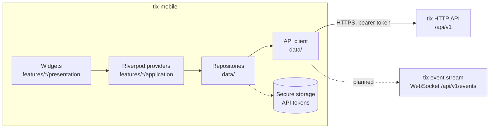

<!-- markdownlint-disable MD013 -->
<p align="center">
  <picture>
    <source media="(prefers-color-scheme: dark)" srcset="assets/branding/logo-dark.svg">
    
  </picture>
</p>

<p align="center">
  The <a href="https://github.com/heliopsy/tix">tix</a> client for Android, iOS, Linux, macOS and Windows.<br>
  Your tasks from a tix server, in one Flutter app.
</p>

<!-- Badge markup and link tables are naturally long; wrapping them helps nobody. -->
<table align="center">
  <tr>
    <th>CI</th>
    <th>Code</th>
    <th>Security</th>
  </tr>
  <tr>
    <td>
      <a href="https://github.com/heliopsy/tix-mobile/actions/workflows/ci.yaml"></a><br>
      <a href="https://github.com/heliopsy/tix-mobile/actions/workflows/release.yaml"></a><br>
      <a href="https://github.com/heliopsy/tix-mobile/actions/workflows/codeql.yaml"></a>
    </td>
    <td>
      <a href="https://github.com/heliopsy/tix-mobile/releases/latest"></a><br>
      <a href="https://codecov.io/gh/heliopsy/tix-mobile"></a><br>
      <a href=".tool-versions"></a><br>
      <a href=".tool-versions"></a>
    </td>
    <td>
      <a href="https://scorecard.dev/viewer/?uri=github.com/heliopsy/tix-mobile"></a><br>
      <a href="SECURITY.md"></a><br>
      <a href="LICENSE"></a><br>
      <a href="CLA.md"></a>
    </td>
  </tr>
</table>
<!-- markdownlint-enable MD013 -->

tix is task management for humans and AI agents: a server with a CLI, a terminal board, an HTTP API, a WebSocket
event stream and a web UI. tix-mobile is a native client for that server. It talks to the same `/api/v1` the CLI
uses when you point it at a server, so a task an agent claims from a terminal is the task you read on your phone a
second later.

> **Status: early, pre-release.** The first slice below is what is being built now. Nothing has been released yet,
> the app has not been run by anyone but its author, and it covers a small part of what the tix API offers.
> Expect rough edges and breaking changes until 1.0. [ROADMAP.md](ROADMAP.md) says what comes next.

## How it fits with tix

```text
tix serve ── /api/v1 (JSON, keyset paginated) ── tix-mobile
    │
    ├── tix CLI, tix TUI, web UI, tix mcp      the same service, other ways in
    └── agents claiming work with leases
```

tix-mobile keeps no data of its own beyond the servers you added and a few preferences. The server is the source of
truth, its rules apply unchanged, and the token you give the app limits what it can see and do, exactly as it would
for the CLI.

## Platforms

| Platform | Minimum | Release artifact | Token stored in |
| --- | --- | --- | --- |
| Android | 7.0, API 24 (Flutter's default `minSdk`) | APK per ABI, AAB | Android Keystore |
| iOS | 15.0 | None yet, build from source | Keychain |
| macOS | 12.0 | `.zip` | Keychain |
| Linux | x64 and arm64 desktop with GTK 3 | `.tar.gz` | libsecret (GNOME Keyring, KWallet) |
| Windows | Windows 10, x64 | `.zip` | DPAPI |

iOS builds are not published until signing is set up. Store listings (Google Play, App Store, F-Droid, Flathub) are
on the [roadmap](ROADMAP.md), not available today.

## Features

The initial scope, and all of it:

- **Connect to a tix server** with its URL and an API token. Save more than one and switch between them, the way
  `tix ctx` does on the command line.
- **Projects** visible to that token.
- **Task lists** with pull to refresh and keyset pagination, so a long list loads a page at a time and stays stable
  while tasks are being added.
- **Task detail** for a single task.
- **Quick add** in tix's one-line syntax: `Fix login !high #auth @raj due:fri`. The server parses the line, so the
  app understands exactly what the CLI and the browser understand.
- **Settings**: light, dark or system theme, English or Bulgarian, and the saved servers.
- **Adaptive layout**: a bottom navigation bar on phones, a navigation rail and a two-pane list and detail on tablets
  and desktops.

The API token is kept in the platform's secure storage and is never written to logs or preferences.

## Screenshots

There are none yet. They arrive with the first release, taken from a real build against a demonstration server, and
live in `screenshots/` ([conventions](docs/development.md#screenshots)).

## Install

### From a release

Download the file for your platform from the [latest release](https://github.com/heliopsy/tix-mobile/releases/latest).
Every release attaches Android APKs (one per ABI: take `arm64-v8a` for any phone from the last several years)
and an AAB, Linux `.tar.gz` files for x64 and arm64, a macOS `.zip`, a Windows `.zip`, and a `SHA256SUMS` file. Each file carries GitHub build provenance, and the checksums file a
cosign signature, so you can check where a download came from:

```sh
sha256sum --check --ignore-missing SHA256SUMS
gh attestation verify tix-mobile-*-linux-x64.tar.gz --repo heliopsy/tix-mobile
```

### From source

```sh
git clone git@github.com:heliopsy/tix-mobile.git
cd tix-mobile
just setup          # toolchain from .tool-versions, dependencies, generated code
just build-linux    # or build-apk, build-macos, build-windows, build-ios
```

[docs/development.md](docs/development.md#prerequisites) lists the per-OS prerequisites.

## Quick start

On the machine running tix, start the server and mint a token for the app:

```sh
tix serve --listen 127.0.0.1:8080
tix token create phone --scope task:read --scope task:write --scope project:read
```

The token is printed once. Those three scopes cover everything the app does today; with a narrower token the app
shows what the server refused. `tix token create` defaults to a 90-day expiry, and `tix token rm ID` revokes the
token if the device is lost. The **Connect an agent** screen in tix's web UI issues tokens too.

In the app, add a server with a name, its URL and the token. That is the whole setup.

A phone cannot reach `127.0.0.1` on your laptop, and tix refuses to bind anything but loopback without TLS. For a
real device, serve tix over TLS, in tix itself or behind a reverse proxy, and give the app the `https://` address
(see tix's [deployment guide](https://github.com/heliopsy/tix/blob/main/docs/deployment.md)). The Android emulator
reaches the host's loopback at `http://10.0.2.2:8080`, and a desktop build on the same machine uses
`http://127.0.0.1:8080` directly.

## Development

```sh
just setup     # first-time setup
just run       # run on a device; pass flutter flags through, e.g. just run -d linux
just check     # fast pre-push gate
just ci        # the CI suite locally
```

Requires [just](https://just.systems/) and [asdf](https://asdf-vm.com/) or [mise](https://mise.jdx.dev/); versions
are pinned in `.tool-versions`. [docs/development.md](docs/development.md) lists every recipe and
[docs/testing.md](docs/testing.md) the test conventions and the coverage floor.

## Architecture

Feature-first, with one direction of dependency. Widgets read Riverpod providers, providers call repositories,
repositories call the API client, and only the API client speaks HTTP.



```text
lib/main.dart                 # bootstrap only
lib/src/app.dart              # MaterialApp.router, theme, l10n
lib/src/core/                 # config, router, theme, l10n, errors, logging, session, storage, paging, widgets
lib/src/data/                 # API client, DTOs and models, repositories
lib/src/features/<feature>/   # presentation/ and application/ (providers)
lib/l10n/                     # app_en.arb, app_bg.arb
test/                         # mirrors lib/src
openspec/                     # normative specs (OpenSpec)
```

[docs/architecture.md](docs/architecture.md) covers the layers, the state management rules, navigation, and how the
client maps tix's error envelope and keyset pagination.

## Documentation

[docs/README.md](docs/README.md) is the index.

| Document | Contents |
| --- | --- |
| [docs/development.md](docs/development.md) | Prerequisites per OS, every `just` recipe, codegen, localisation, emulators, screenshots |
| [docs/architecture.md](docs/architecture.md) | Layers, state management, navigation, errors, pagination |
| [docs/testing.md](docs/testing.md) | Unit, widget and golden tests, the coverage floor, watching a guard fail |
| [docs/releasing.md](docs/releasing.md) | release-please, release artifacts, signing secrets |

| | |
| --- | --- |
| [AGENTS.md](AGENTS.md) | Coding standards and architecture invariants |
| [CONTRIBUTING.md](CONTRIBUTING.md) | Build, test and pull request process |
| [ROADMAP.md](ROADMAP.md) | What comes after the first slice |
| [SECURITY.md](SECURITY.md) | Reporting a vulnerability |
| [CODE_OF_CONDUCT.md](CODE_OF_CONDUCT.md) | Expected behaviour in issues, pull requests and reviews |

## Roadmap

After the first slice: live updates over the tix event stream, an offline cache, push notifications, home screen
widgets, Wear OS and Apple Watch companions, and store releases. [ROADMAP.md](ROADMAP.md) has the detail and the open
questions for each.

## Contributing

Bug reports and pull requests are welcome. Read [CONTRIBUTING.md](CONTRIBUTING.md) first: behaviour changes start in
`openspec/`, and the PR title is a Conventional Commit. Contributions are accepted under the [CLA](CLA.md), and a bot
asks you to sign it on your first pull request.

Problems with the server itself belong in [heliopsy/tix](https://github.com/heliopsy/tix/issues).

## Licence

[AGPL-3.0-or-later](LICENSE). Contributions are accepted under the [CLA](CLA.md), which keeps the option of offering
tix-mobile under other terms in future, including the terms app stores require.
