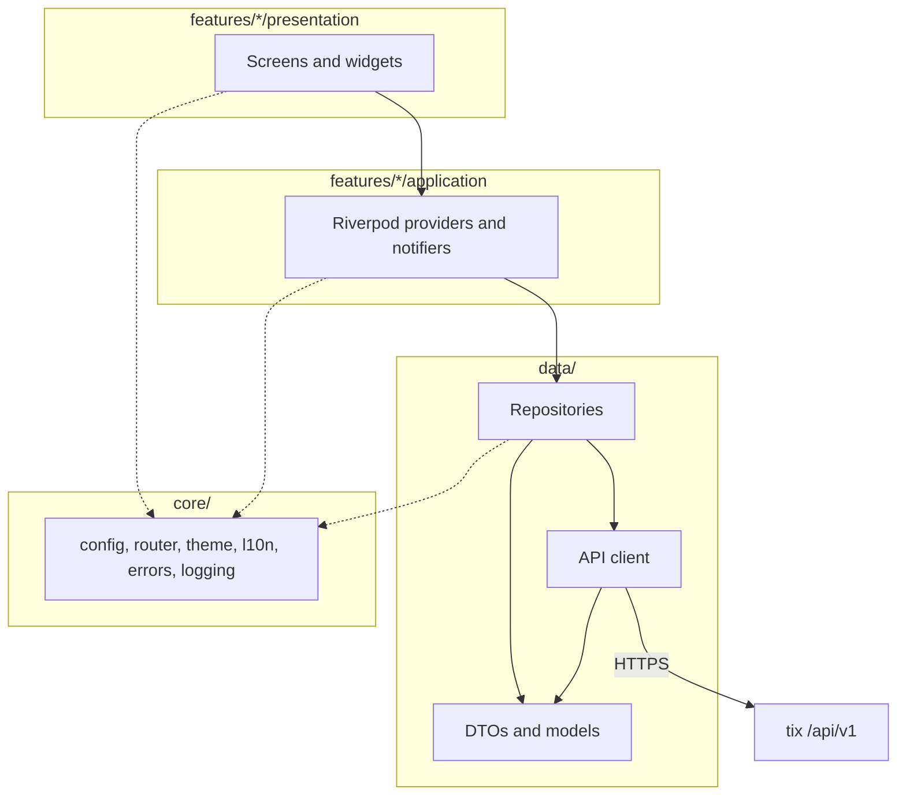
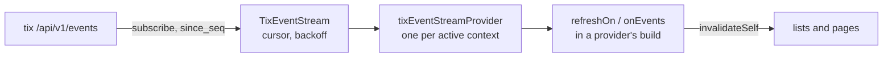
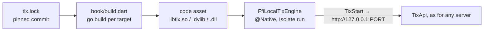

# Architecture

How the app is put together, and the rules that keep it that way. [AGENTS.md](../AGENTS.md) has the terse version
of the same rules; this page has the reasons.

## Layers



Dependencies point one way, down and to the right. A layer never imports from the one above it.

| Layer | Lives in | Owns | Never |
| --- | --- | --- | --- |
| Presentation | `lib/src/features/<feature>/presentation/` | Widgets, layout, user input, localised text | Calls a repository or the API client, holds business state |
| Application | `lib/src/features/<feature>/application/` | Providers and notifiers: loading, paging, refreshing, mutating | Builds widgets, knows about HTTP |
| Data | `lib/src/data/` | The API client, request and response DTOs, the models the app uses, repositories | Imports Flutter widgets or Riverpod |
| Core | `lib/src/core/` | Configuration, the router, themes, localisation setup, the error types, logging, session, storage, paging, shared widgets | Depends on a feature (only `core/router` imports feature screens, to wire routes) |

`lib/main.dart` only bootstraps: it initialises bindings, builds the root `ProviderScope` and runs `App` from
`lib/src/app.dart`. `App` is a `MaterialApp.router` that wires the router, the light and dark themes and the
localisation delegates. Nothing else belongs in either file.

A feature does not import another feature. Anything two features need moves to `data/` or `core/`.

## The data layer

### The pinned API description

`api/tix-openapi.yaml` is tix's own `api/openapi.yaml` at the commit `tix.lock` pins, the same pin the engine is
built from, so the app's client and its embedded engine always describe one tix version. `just openapi-check` (in
CI) fails while the copy differs; `just openapi-sync` refreshes it.

### Generated client

`tool/openapi.dart gen` turns the spec into two committed files under `lib/src/data/api/gen/`:

- `models.gen.dart`: one freezed + json_serializable class per schema and one enum per string enum. A schema a
  request body uses is an input, with every field nullable so a PATCH sends only what is set; the rest default to
  zero values and empty lists. An input field whose description says null clears it is a `Patch<T>?` (`json.dart`):
  null leaves it out, `Patch(v)` sends `v` and `Patch.clear()` sends a JSON null, through the class's generated
  `toBody()`, which the client sends. Unknown fields are ignored and an unknown enum value reads as null, because tix adds
  both without a version bump. `Connection`, `Membership` and `Session` are renamed `LiveConnection`,
  `TenantMembership` and `AuthSession`, so they cannot be confused with the app's own classes.
- `client.gen.dart`: `TixClient`, one group per area and one method per operation, named from the operationId:
  `task.list` is `api.task.list(...)`, `inbox.channel.add` is `api.inbox.channelAdd(...)`. Path parameters are
  positional, the body follows, query parameters are named. A listing returns `Page<T>`; a GET listing also has an
  NDJSON twin (`listStream`) that streams items.

Why a generator of our own rather than a package is in the `api-foundation` design
(`openspec/changes/archive/*-api-foundation/design.md`). `data/models/*.dart` re-export the generated classes the
app uses by name (`Task`, `Project`, `Actor`), so screens import a stable path.

### Transport

`TixApi` extends `TixClient` with one Dio per connection, holding its base URL and a `Credential` read from secure
storage. An API token goes out as `Authorization: Bearer <token>`. A sign-in session goes out as the `tix_session`
cookie and nothing else: tix's bearer authenticator accepts API tokens only and refuses the request when a session
token arrives there. `X-Tix-Tenant` is sent only when a sign-in on a shared host names a tenant. `X-Tix-Client` is
not sent: tix defines only `cli` and `mcp`.

Every generated method goes through `TixTransport`, which encodes the query (lists repeated, instants in UTC),
decodes JSON, text, files and NDJSON, and turns every failure, a failed stream included, into one `TixException`.
It performs no validation and applies no rules: whatever the server decides is the answer. This mirrors tix's own
`internal/client`, which marshals and nothing else. The client never logs a token, a full `Authorization` header,
or a request body that may contain one.

### Repositories

A repository is the only thing a provider talks to. It turns DTOs into the models the UI uses, hides which endpoint
serves what, and keeps cached copies (below) without the providers noticing.

## Live updates



`TixEventStream` (`data/events`) holds one WebSocket per active context, presenting the connection's credential.
It subscribes, delivers each event once in `seq` order, and on a dropped connection retries after 1, 2, 4 … 60
seconds (plus jitter), resuming with `since_seq`. Coming back to the foreground skips the wait. A refused
handshake or subscription (a token without `event:subscribe`) makes it unavailable, with no retries. A cursor tix
no longer keeps, or a reconnect before any event arrived, is reported as `EventsMissed`.

A provider declares what it depends on in `build`:

```dart
refreshOn(ref, EventTopics.taskDetail, where: (e) => e.subjectId == task.id);
```

It refreshes when a matching event arrives, at most once per 300 ms burst, and on every gap. `onEvents` hands the
batch over instead, for a provider that patches its state. `EventTopics` in `core/events/invalidation.dart` is the
table of which events touch which data.

## Cache

The last good first page of each listing and the last read of each record are kept per context, one JSON file per
entry under the app support directory (`cache/v1/<connection>/<tenant>/<key>.json`). Nothing is ever queried,
only read by key, so files are enough and add no native code. The cache is best effort: an unreadable entry is a
miss and a failed write is dropped. Removing a connection deletes its directory.

A repository wraps a read in `ResponseCache.remember` and offers a `cached…` twin; a provider builds with
`cachedFirst`, which returns the cached value at once and sets the server's when it arrives. Each key is served
from the cache once per context, so a pull to refresh always asks the server and shows its error.

## Optimistic updates

The design system's `runOptimistic` (`core/design/components/toast.dart`) shows the change, the error toast and the
Undo. It takes `apply` and `rollback` callbacks, which have to change provider state, so a notifier hands out an
`OptimisticChange` (`core/cache/optimistic.dart`) and the widget passes its members on.

## Parity with the web UI

The app aims to do everything the tix web UI does. As in tix's `internal/capability`, every operation is
classified once: bound in `core/capability/registry.dart` (operationId to feature, action and the wave it shipped
in), or listed in `core/capability/exemptions.yaml` as exempt with a reason or pending in a wave.
`test/core/capability/operations_test.dart` fails on an operation in neither, in both, or gone from the spec, so a
tix bump that adds an operation fails until someone decides about it. `just parity` prints coverage per wave.

## Building a feature on the data layer

The steps for a screen that performs an operation, say `task.star`:

1. **Find the method.** `lib/src/data/api/gen/client.gen.dart` has it: `api.task.star(ref)`. Its doc names the route
   and scope. If tix lacks something, it is a tix change first; never hand-write a request.
2. **Repository.** Add a method to the repository for the area (or a new one in `data/repositories/`, built in
   `core/session/session.dart` from `sessionApiProvider` and `responseCacheProvider`). Reads that open a screen use
   `_cache.remember(key, fresh, encode)` and get a `cached…` twin; first pages only, never a page after a cursor.
   Never cache anything carrying a secret (tokens, sessions, recovery codes, invite links).
3. **Provider.** In `features/<feature>/application/`, an `AsyncNotifier`:
   - load with `cachedFirst(ref: ref, cached: repo.cachedX(), fresh: repo.x, onFresh: (v) => state = AsyncData(v))`;
   - declare live updates with `refreshOn(ref, EventTopics.<topic>, where: ...)`;
   - page with `loadNextPage` from `core/paging`;
   - expose each mutation as a method returning an `OptimisticChange` (quick actions) or a `Future` (forms).
4. **Screen.** Watch the provider; run a quick action with `runOptimistic(context, apply: c.apply, rollback:
   c.rollback, commit: c.commit, undo: c.undo, ...)`; show errors with the shared error views.
5. **Parity.** Move the operationId from `pending` in `exemptions.yaml` to `bindings` in `registry.dart` with the
   feature, action and wave. Run `flutter test test/core/capability` and `just parity`.
6. **Tests.** Extend `FakeTix` with the route, test the repository against it, the provider through a
   `ProviderContainer`, and the screen at both widths. For live updates, pass a `FakeEventSockets` connector to
   `fakeOverrides(events: ...)` and push events.

## The filter expression

`GET /api/v1/tasks` takes parameters, not tix's filter expression. tix's own CLI parses the expression on the
client and sends parameters, and the app does the same: `data/query/filter_expression.dart` ports `internal/query`
term for term (keys, `-` negation, the `~` operator, quotes, `due:` windows against the clock, priority names) and
leaves every value for the server to judge. A key the language does not have is refused under the field with
tix's own wording, before anything is sent. A saved filter's expression is checked by the server when saved.

The task screen's list, board and lanes draw one query, as the web does. The list narrows to the unfinished
states of the tenant's workflows when the expression names no status; the board and the lanes do not. A board
needs one workflow, so projects whose workflows differ in states or transitions get the list and a notice.

## What the credential may do

`currentAccessProvider` (`core/session/access.dart`) reads `whoami` once per context, cached like any read, and
answers `Access.has(scope)` as tix's `Actor.HasScope` does: direct scopes, then the role's bundle, `*` covering all
but `global:admin` and `account:read`. Screens leave out what the credential cannot do rather than letting the
server refuse it, and say when a screen is read only.

The Manage destination lists every management area from `features/manage/manage_sections.dart`, a flat list of
`ManageEntry` values (group, icon, title, route, scope). A new area adds one entry there and its route in
`core/router`; the hub groups and filters the entries itself. On a phone the bottom bar holds at most five
destinations, the rest open from More.

## Instances, connections and the active context

- An **instance** is a tix server: `remote` (an address) or `local` (a `.db` file served by tix embedded in the
  app over loopback HTTP).
- A **connection** is one identity on an instance: an API token, pinned by tix to the tenant it was minted in, or
  a sign-in holding a session. A sign-in is pinned to one tenant or switchable between the person's memberships;
  switching calls `POST /api/v1/auth/switch`, which mints a session in the target and ends the old one.
- The **active context** is a connection and the tenant it targets. `SessionController` in `core/session` builds
  it, and everything that talks to the server watches it, so switching rebuilds the client and every list.

| Where | Key | Holds |
| --- | --- | --- |
| Preferences | `instances`, `connections` | The saved instances and connections, no secrets |
| Preferences | `context.active`, `context.recent` | The active context and the recent ones |
| Secure storage | `token.<connection>` | An API token (the 0.1 key, so upgrading moves nothing) |
| Secure storage | `session.<connection>` | A sign-in's session token |

The 0.1 list of servers is migrated once, on first start: each becomes a token connection with the same id on a
remote instance per address. `whoami` names the tenant only for a person's session; for a token the app reads
`GET /api/v1/tenants/{id}`, which needs `tenant:admin`, and leaves a narrower token's tenant unnamed.

A local instance's engine sits behind `LocalTixEngine` in `data/local`. It starts when a local context becomes
active and stops when another instance becomes active or the app exits. On phones it also stops while the app is in
the background and restarts on resume, asking for the port it had so the session's address stays valid; if the port
is taken, the session rebuilds against the new one.

## The local engine

The engine is tix itself, built as a C library (`embedded/libtix` in tix) and loaded with `dart:ffi`.



- **Building.** `hook/build.dart` runs inside every `flutter build`, `run` and `test`. It fetches tix at the commit
  `tix.lock` pins, builds libtix with Go for the platform and architecture being built, caches the result under
  `~/.cache/tix-mobile/libtix`, and bundles it as a code asset. Flutter places it where each platform loads native
  code from. Without Go it bundles nothing and the app falls back to `UnavailableLocalTixEngine`.
- **Calling.** `FfiLocalTixEngine` binds the seven `Tix*` functions with `@Native`. Every call blocks inside tix, so
  each runs on a short-lived isolate; every returned string is freed with `TixFree`, and the JSON error object
  becomes a `TixException`. Tests use `InMemoryLocalTixEngine`, and one integration test drives the real library.
- **Files.** SQLite needs a real path and writes `-wal` and `-shm` files beside the database. Android and iOS
  pickers hand over a copy, and the macOS sandbox does not let the app create files beside one the person picked,
  so by default those platforms import a copy into the documents folder and export it (engine stopped, so the file
  is whole) through the share sheet or a save dialog.
- **Open in place.** An advanced choice on the add-instance screen uses a database where it is, and saves the
  instance with `inPlace` (and a `bookmark` on Apple platforms). `LocalFileAccess` (`core/platform/local_access.dart`)
  hides how each platform gets there:

  | Platform | How | Stored |
  | --- | --- | --- |
  | Linux, Windows | The system open dialog | the path |
  | Android | "All files access", then an in-app browser of shared storage | the path |
  | iOS, macOS | A native folder picker, a security-scoped bookmark of the folder | the path and the bookmark |

  Apple platforms bookmark the folder because SQLite must create files beside the database. The bookmark is
  resolved and access started before the engine starts and released after it stops; a stale one is renewed and
  saved through `LocalEngines.renewed`. On Android `MANAGE_EXTERNAL_STORAGE` lives in an overlay manifest
  (`android/app/src/allFilesAccess/`) that Gradle merges unless the build passes `-PtixAllFilesAccess=false`, which a
  Google Play build should, since Play restricts the permission; the app offers open in place only when the
  permission is declared. SAF content URIs are never used: SQLite cannot lock through them.
- **Sync safety.** Before opening in place, `probeInPlace` (`data/local/in_place.dart`) checks the folder takes new
  files, the file starts with the SQLite header and can be locked; an iCloud file not yet downloaded is refused.
  Conflict copies (`name (conflicted copy ...).db`, `name.sync-conflict-....db`, `name (1).db`, `name 2.db`) and a
  leftover `-wal` are looked for whenever the engine starts and shown on the connect screen and the Instances card.
  In-place engines rest whenever the app is hidden, on every platform: tix closes the database on stop, SQLite
  checkpoints the log into the file and removes `-wal`, and the sync client sees one whole file.
- **Lifecycle.** `LocalEngines` runs at most one engine: activating any context stops every other instance's
  engine, and a remote context stops them all. Phones suspend engines on pause and resume them on the same
  address. An engine that served no request for the idle timeout (10 minutes by default, `settings.local_idle_minutes`,
  0 for never) rests: it stops and remembers its address. The session's client for a local instance carries a
  `LocalWakeInterceptor`, which calls `LocalEngines.ensure` before every request and rewrites its base URL, so a
  resting engine starts again, on the same address when it is free, before the request goes out. The Instances
  screen shows each engine's state from `localEngineStatusesProvider`, with a Stop button that rests it.
- **Talking to it.** Once started, a local instance is an ordinary server on loopback: the same `TixApi`, the same
  errors. Android allows cleartext HTTP to `127.0.0.1` only; Apple platforms set `NSAllowsLocalNetworking`.

## Licences

`TixBinding` replaces Flutter's licence collector. It lists Flutter's notices for runtime packages only (the
closure of `dependencies`, generated into `core/licences/packages.g.dart` from `dart pub deps`) and the engine's
components, leaves out licences that ask for no notice (CC0, the Unlicense, 0BSD), and adds tix and the Go modules
libtix links for this platform from `assets/licenses/libtix.json`.

## Errors

tix answers every failure with one envelope:

```json
{"error":{"code":"not_found","message":"task \"default-999\"","details":{}}}
```

The API client reads `code` into a closed set of error kinds and keeps `message` and `details` alongside it:

| `code` | HTTP status | What the app does |
| --- | --- | --- |
| `invalid` | 400 | Shows the server's message next to the input that caused it |
| `unauthenticated` | 401 | The token or session is wrong, expired or revoked: show the error; for a sign-in, offer to sign in again, keeping the connection |
| `forbidden` | 403 | The token lacks a scope: say which action was refused, do not retry |
| `not_found` | 404 | The item is gone or not visible to this token |
| `conflict`, `lease_expired` | 409 | Someone changed it first: reload and show the current state |
| `precondition_failed` | 422 | Show the server's message; the action is not allowed in this state |
| `internal` | 500 | Generic failure with the `X-Request-Id`, so a server log line can be found |

Everything else is classified on the client: no network, timeout, TLS failure, a response that is not the
envelope (a proxy's HTML error page, for example), and an unknown `code` from a newer server, which is shown with
its message rather than dropped.

Errors travel up as values. A provider exposes them through `AsyncValue.error`, and the presentation layer renders
them with the shared error widgets in `core/`, using localised text for the kind and the server's `message` for
the detail. No layer catches an error only to hide it.

## Keyset pagination

Every tix listing is keyset paginated. A request takes `limit` and an optional `cursor`, and the response is:

```json
{"items":[...],"next_cursor":"..."}
```

Passing `next_cursor` back as `cursor` gives the next page. An empty or absent `next_cursor` means the last page.
There is no offset and no total count.

The list notifiers hold the items loaded so far, the cursor for the next page, and whether a page is in flight:

- **First load and pull to refresh** request without a cursor and replace the list.
- **Scrolling near the end** requests the next page with the stored cursor and appends. Only one page request runs
  at a time, and none runs once the last page has arrived.
- **A filter or sort change** discards the cursor and starts again. A cursor is valid only for the query that
  produced it.
- **An item can appear twice** when it moves between pages while you scroll, a property of keyset pagination that
  tix documents. Appending de-duplicates by task id.

## Quick add

Quick add sends the typed line as the title of `POST /api/v1/tasks` with `"parse": true`. The server parses
`!high`, `#tag`, `@handle`, `due:fri` and the rest, exactly as it does for the CLI and the browser. The app does not
parse the line itself, so it cannot drift from the server's grammar. Relative dates count in UTC on the server, as
tix's API documents.

The live preview is the server's too. tix's API has no preview call, but its task import does a dry run of quick-add
lines (`task.import` with `format: lines`, `dry_run: true`) and returns each row as it would create it. The sheet
sends a bare title and the typed line, 300 ms after typing pauses, and shows what differs from the bare title as
chips; only the newest answer is drawn. A credential without the `import` scope is refused once and previews stop for
that context. A line naming a project (`+ops`) is refused by the import, so picking a `+` completion moves the
project into the picker instead.

One sheet serves every entry point. Features write a `QuickAddDraft` into `quickAddDraftsProvider`
(`core/quick`): the shell's button, Ctrl+N, the palette, Android shares and launcher shortcuts. `QuickActionsHost`,
which the router mounts around the signed-in shell, opens the sheet for each draft. A draft written while nobody is
signed in waits; an Android share waits in `MainActivity` until Dart takes it over the `tix/share` channel. A
created task bumps `tasksChangedProvider`, which project lists watch. Quick add needs the server: offline, it keeps
the line and says so.

## State management

- Providers are written with `riverpod_annotation` and generated by `build_runner`. Hand-written providers are the
  exception and need a reason.
- A provider that loads data is an `AsyncNotifier` (or a generated function provider for read-only data) and
  exposes `AsyncValue`. Widgets switch on it for loading, data and error.
- Widgets `ref.watch` in `build` and `ref.read` in callbacks. `ref.listen` is for side effects such as snack bars
  and navigation, never for building UI.
- The active context is a provider. Everything that talks to the API depends on it, so switching instance or
  tenant rebuilds the client and invalidates every cached list without explicit bookkeeping.
- Mutations go through notifier methods that call the repository, then update or invalidate the affected state.
  A widget never calls a repository directly.

## Navigation

`go_router` owns navigation, configured in `core/router`. Routes are paths, so a task has a stable address
(`/projects/:key/tasks/:ref`) that works for back navigation, desktop windows and, later, deep links.

The shell adapts to the window width, using Material 3's window size classes:

| Width | Navigation | Lists and detail |
| --- | --- | --- |
| Compact, under 600 | Bottom navigation bar | Detail pushes over the list |
| Medium, 600 to 839 | Navigation rail | Detail pushes over the list |
| Expanded, 840 and over | Navigation rail | List and detail side by side |

The layout reacts to the width, not to the platform, so a narrow desktop window behaves like a phone and a wide
tablet like a desktop.

When no context is active, the router redirects to the connect screen. The context switcher sits above the
bottom navigation bar on phones and at the top of the navigation rail elsewhere.

## Secrets and preferences

- API tokens and session tokens live only in platform secure storage: Keychain on iOS and macOS, Android Keystore,
  libsecret on Linux, DPAPI on Windows. Passwords are never stored.
- The saved instances and connections (names, addresses, handles, tenants), the theme and the language are
  ordinary preferences.
- The response cache is the only copy of server data the app keeps: under the app support directory, per
  connection and tenant, deleted with its connection. It never holds a token or a session.

## Specs

`openspec/` is the normative contract. A behaviour change updates the spec before the code, and the spec says what
the app does from a user's point of view; this page says how.
