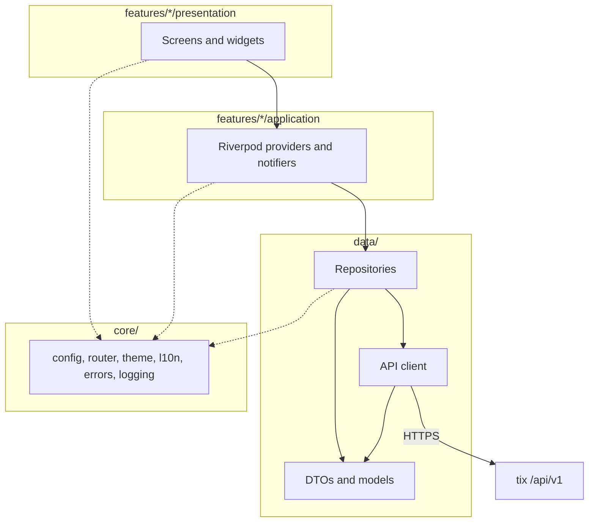

# Architecture

How the app is put together, and the rules that keep it that way. [AGENTS.md](../AGENTS.md) has the terse version
of the same rules; this page has the reasons.

## Layers



Dependencies point one way, down and to the right. A layer never imports from the one above it.

| Layer | Lives in | Owns | Never |
| --- | --- | --- | --- |
| Presentation | `lib/src/features/<feature>/presentation/` | Widgets, layout, user input, localised text | Calls a repository or the API client, holds business state |
| Application | `lib/src/features/<feature>/application/` | Providers and notifiers: loading, paging, refreshing, mutating | Builds widgets, knows about HTTP |
| Data | `lib/src/data/` | The API client, request and response DTOs, the models the app uses, repositories | Imports Flutter widgets or Riverpod |
| Core | `lib/src/core/` | Configuration, the router, themes, localisation setup, the error types, logging, session, storage, paging, shared widgets | Depends on a feature (only `core/router` imports feature screens, to wire routes) |

`lib/main.dart` only bootstraps: it initialises bindings, builds the root `ProviderScope` and runs `App` from
`lib/src/app.dart`. `App` is a `MaterialApp.router` that wires the router, the light and dark themes and the
localisation delegates. Nothing else belongs in either file.

A feature does not import another feature. Anything two features need moves to `data/` or `core/`.

## The data layer

### API client

One client per saved server, holding its base URL and reading its token from secure storage. It sends
`Authorization: Bearer <token>` and JSON, decodes JSON, and maps failures to typed errors. It performs no
validation and applies no rules: whatever the server decides is the answer. This mirrors tix's own
`internal/client`, which marshals and nothing else.

The client never logs a token, a full `Authorization` header, or a request body that may contain one.

### DTOs and models

Request and response shapes are immutable classes with generated JSON mapping. Unknown fields in a response are
ignored rather than rejected, because tix adds fields without a version bump and an older app must keep working
against a newer server.

### Repositories

A repository is the only thing a provider talks to. It turns DTOs into the models the UI uses, hides which endpoint
serves what, and is the seam a later offline cache slots into without the providers noticing.

## Errors

tix answers every failure with one envelope:

```json
{"error":{"code":"not_found","message":"task \"default-999\"","details":{}}}
```

The API client reads `code` into a closed set of error kinds and keeps `message` and `details` alongside it:

| `code` | HTTP status | What the app does |
| --- | --- | --- |
| `invalid` | 400 | Shows the server's message next to the input that caused it |
| `unauthenticated` | 401 | The token is wrong, expired or revoked: show the error and send the user back to the connect screen to fix that server (in-place token replacement is planned) |
| `forbidden` | 403 | The token lacks a scope: say which action was refused, do not retry |
| `not_found` | 404 | The item is gone or not visible to this token |
| `conflict`, `lease_expired` | 409 | Someone changed it first: reload and show the current state |
| `precondition_failed` | 422 | Show the server's message; the action is not allowed in this state |
| `internal` | 500 | Generic failure with the `X-Request-Id`, so a server log line can be found |

Everything else is classified on the client: no network, timeout, TLS failure, a response that is not the
envelope (a proxy's HTML error page, for example), and an unknown `code` from a newer server, which is shown with
its message rather than dropped.

Errors travel up as values. A provider exposes them through `AsyncValue.error`, and the presentation layer renders
them with the shared error widgets in `core/`, using localised text for the kind and the server's `message` for
the detail. No layer catches an error only to hide it.

## Keyset pagination

Every tix listing is keyset paginated. A request takes `limit` and an optional `cursor`, and the response is:

```json
{"items":[...],"next_cursor":"..."}
```

Passing `next_cursor` back as `cursor` gives the next page. An empty or absent `next_cursor` means the last page.
There is no offset and no total count.

The list notifiers hold the items loaded so far, the cursor for the next page, and whether a page is in flight:

- **First load and pull to refresh** request without a cursor and replace the list.
- **Scrolling near the end** requests the next page with the stored cursor and appends. Only one page request runs
  at a time, and none runs once the last page has arrived.
- **A filter or sort change** discards the cursor and starts again. A cursor is valid only for the query that
  produced it.
- **An item can appear twice** when it moves between pages while you scroll, a property of keyset pagination that
  tix documents. Appending de-duplicates by task id.

## Quick add

Quick add sends the typed line as the title of `POST /api/v1/tasks` with `"parse": true`. The server parses
`!high`, `#tag`, `@handle`, `due:fri` and the rest, exactly as it does for the CLI and the browser. The app does not
parse the line itself, so it cannot drift from the server's grammar. Relative dates count in UTC on the server, as
tix's API documents.

## State management

- Providers are written with `riverpod_annotation` and generated by `build_runner`. Hand-written providers are the
  exception and need a reason.
- A provider that loads data is an `AsyncNotifier` (or a generated function provider for read-only data) and
  exposes `AsyncValue`. Widgets switch on it for loading, data and error.
- Widgets `ref.watch` in `build` and `ref.read` in callbacks. `ref.listen` is for side effects such as snack bars
  and navigation, never for building UI.
- The active server is a provider. Everything that talks to the API depends on it, so switching servers rebuilds
  the client and invalidates every cached list without explicit bookkeeping.
- Mutations go through notifier methods that call the repository, then update or invalidate the affected state.
  A widget never calls a repository directly.

## Navigation

`go_router` owns navigation, configured in `core/router`. Routes are paths, so a task has a stable address
(`/projects/:key/tasks/:ref`) that works for back navigation, desktop windows and, later, deep links.

The shell adapts to the window width, using Material 3's window size classes:

| Width | Navigation | Lists and detail |
| --- | --- | --- |
| Compact, under 600 | Bottom navigation bar | Detail pushes over the list |
| Medium, 600 to 839 | Navigation rail | Detail pushes over the list |
| Expanded, 840 and over | Navigation rail | List and detail side by side |

The layout reacts to the width, not to the platform, so a narrow desktop window behaves like a phone and a wide
tablet like a desktop.

When no server is saved, the router redirects to the connect screen.

## Secrets and preferences

- API tokens live only in platform secure storage: Keychain on iOS and macOS, Android Keystore, libsecret on Linux,
  DPAPI on Windows.
- The saved servers' names and URLs, the theme and the language are ordinary preferences.
- Nothing the app stores is a copy of server data. The future offline cache will change that, and will be specified
  in `openspec/` before it is built.

## Specs

`openspec/` is the normative contract. A behaviour change updates the spec before the code, and the spec says what
the app does from a user's point of view; this page says how.
