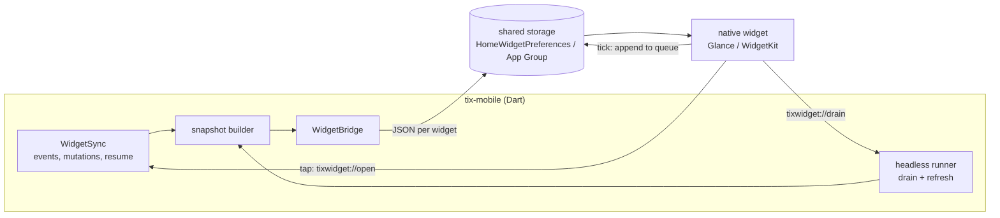

# Home screen widgets

Four widgets put tix on the home screen: **My work**, **Inbox**, **Quick add** and **Project**. Their UI is native
on every platform (Jetpack Glance on Android, WidgetKit and SwiftUI on iOS and macOS), because a widget cannot run
Flutter. The app feeds them a small JSON snapshot and takes their taps back. The `home_widget` package carries both
on Android and iOS; on macOS, which `home_widget` does not support, a small `tix/widgets` method channel does the
same job.

| Widget | Shows | Taps |
| --- | --- | --- |
| My work | Your next open tasks, overdue and due today first, with the total | Tick completes the task; a row opens it |
| Inbox | The unread count and the latest items | An item opens its task (and marks it read); the header opens the inbox |
| Quick add | One button | Opens the quick add sheet, in the widget's project when it has one |
| Project | A project's open tasks under each unfinished status, with counts | A row opens the task; the header opens the project |

| Platform | Sizes | Interactive tick | Lock screen |
| --- | --- | --- | --- |
| Android 6+ | Resizable from 2x1 to 5x5; My work, Inbox and Project grow from a count to a list | Glance action, Android 12+ draws it as a checkbox | Keyguard host (Android 16 hub): counts only when asked |
| iOS 17+ | Small, medium, large (Quick add: small) | App Intent button | Inbox count as circular, rectangular and inline accessories |
| macOS 14+ | Small, medium, large (Quick add: small) | App Intent button | None |
| Windows, Linux | None, see [below](#windows-and-linux) | | |

The app itself keeps its iOS 15 and macOS 12 floor; the widget extensions need iOS 17 and macOS 14, for configurable
App Intent widgets and interactive buttons. On older systems the app runs and the widgets are not offered.

## How data flows



- **Writes.** `WidgetSync`, mounted around the signed-in shell, rebuilds the snapshots when the session changes,
  when an event touches tasks, the inbox or projects (at most once per two seconds), after the app resumes, after a
  task is created, when the theme, language or widget privacy changes, and when the app goes out of sight, which
  catches any change the event stream missed just before the person looks at the home screen. It writes one key
  per widget kind and context, then asks the platform to redraw.
- **Background refresh.** Android schedules a periodic WorkManager job (every 30 minutes, network required) while
  any tix widget exists; it wakes the headless runner with `tixwidget://refresh`. iOS submits a `BGAppRefreshTask`
  whenever the app goes to the background, and runs the same refresh in a headless Flutter engine. WidgetKit
  timelines re-read storage every 30 minutes and draw the snapshot's age with a self-updating relative date, so an
  old snapshot says so without a reload. macOS refreshes while the app runs.
- **Ticks.** A tick never talks to the server from the widget. The widget appends the action to the queue in shared
  storage, hides the task at once (it filters out queued refs), and wakes the app's Dart code: on Android through
  `home_widget`'s background receiver, which starts a headless engine; on iOS through the App Intent, which runs in
  the app's process and starts a headless engine; on macOS by posting a Darwin notification the running app
  hears. The Dart side drains the queue with the app's ordinary session code: it reads the connection's credential
  from secure storage, completes the task by its workflow's done state, and rewrites the snapshot. Whatever cannot
  run now (offline, a locked iPhone whose keychain is closed, a local instance, macOS with the app closed) stays
  queued and runs the next time the app opens.
- **Taps.** Rows and headers open `tixwidget://open?...`. The app switches to the widget's context when it is not
  the active one, then goes to the route; an inbox item is marked read.

Why a headless Dart callback rather than queue-only: a tick on a phone should reach the server in seconds, not when
the person next opens the app, and the callback reuses the app's own repositories and workflow rules instead of
re-implementing them in Kotlin and Swift. Why the queue anyway: it is the optimistic state the widget draws, it
survives every case where the callback cannot run, and it keeps the widget free of any credential.

### No secrets in shared storage

Widget storage holds only what the widget draws: titles, references, counts, colours and labels. It never holds an
API token, a session, a password, a server address or anything read from secure storage. The snapshot types have no
field that could carry one, and `test/features/widgets/` writes snapshots for a session holding a token and fails
if the token appears in any value the bridge received. Credentials stay in Keychain and the Android Keystore, read
only by Dart code, in the app process.

### Local instances

A widget never starts the embedded engine. The headless runner skips local contexts entirely, so a phone's battery
is not spent serving a database in the background. Their widgets show the last snapshot with its age and a
"Refreshes when tix is open" line, and a tick on one waits in the queue until the app runs that context.

### Privacy

Settings, Widgets, **Counts only on the lock screen** (on by default) is written into the index. On the iOS lock
screen the inbox accessory then shows the count and no titles, and home-screen widgets mark titles privacy sensitive,
so iOS redacts them while the phone is locked. On Android a widget placed on the keyguard (the Android 16 lock
screen hub) draws counts only. Turning it off lets the rectangular accessory show the newest item.

## Several instances

A widget follows the active context unless, when it is added (or edited), it is pinned to a specific instance and
tenant. Every widget names its context in its footer ("Work · Acme"). The pickers read the catalog of contexts and
projects the app writes into the index; there is nothing to pick before the app has run once.

- Android: a small native configuration activity (`WidgetConfigureActivity`) opens when a configurable widget is
  added (optional on Android 12+, where the widget starts on the active context) and from the widget's edit button.
- iOS and macOS: App Intent configuration, with a context parameter (default: follow the active context) and, for
  Project, a project parameter.

The app writes snapshots for the active context and for every context a widget asks for. A widget's request is
recorded in `tix.widget.wanted`; requests not renewed for 14 days are dropped.

## The contract

All keys and values are strings; values are JSON. Every snapshot carries `"v": 1`; a widget seeing another version
draws "Open tix to update" and nothing else. Times are milliseconds since the epoch, UTC.

### Keys

| Key | Written by | Holds |
| --- | --- | --- |
| `tix.widget.index` | app | The index: active context, contexts, projects per context, theme, privacy, labels |
| `tix.widget.mywork.<ctx>` | app | My work for context `<ctx>` |
| `tix.widget.inbox.<ctx>` | app | Inbox for `<ctx>` |
| `tix.widget.project.<ctx>.<KEY>` | app | Project `<KEY>` in `<ctx>` |
| `tix.widget.queue` | widget appends, app drains | Pending widget actions |
| `tix.widget.wanted` | widget | Contexts and projects configured widgets need |

`<ctx>` is `<connectionId>.<tenantKey>`, the same key notifications use. A widget following the active context
reads `index.active` and then that context's keys.

### Index

```json
{
  "v": 1,
  "at": 1762600000000,
  "active": "c1.acme",
  "contexts": [{"id": "c1.acme", "instance": "Work", "tenant": "Acme", "local": false}],
  "projects": {"c1.acme": [{"key": "OPS", "name": "Operations", "colour": {"light": "#1d4ed8", "dark": "#60a5fa"}}]},
  "theme": "system",
  "systemBlack": false,
  "lockCounts": true,
  "strings": {
    "myWork": "My work", "inbox": "Inbox", "quickAdd": "Quick add", "addTask": "Add a task",
    "nothingDue": "Nothing assigned to you", "allRead": "All caught up", "noOpenTasks": "No open tasks",
    "updated": "Updated", "openApp": "Open tix to load this widget", "localStale": "Refreshes when tix is open",
    "overdue": "Overdue", "today": "Today", "complete": "Complete", "projectMissing": "Not in this context",
    "signedOut": "Sign in to tix", "openUpdate": "Open tix to update", "pickProject": "Pick a project"
  }
}
```

`theme` is `system`, `light`, `dark` or `black`. Widgets use OLED tokens for `black`, and for `system` with
`systemBlack` when the system is dark.

### Shared header

Every snapshot starts with:

```json
{
  "v": 1,
  "at": 1762600000000,
  "ctx": {"id": "c1.acme", "instance": "Work", "tenant": "Acme", "local": false},
  "accent": {"light": "#0f766e", "dark": "#2dd4bf", "onLight": "#ffffff", "onDark": "#08231a"}
}
```

`accent` is the tenant's, already resolved and contrast-checked by `TixAccent` and `TixTokens.withAccent`. OLED uses
the dark values.

### My work

```json
{
  "...": "header",
  "total": 14,
  "more": true,
  "moreText": "+9 more",
  "tasks": [{
    "ref": "OPS-12", "title": "Rotate the TLS certificates", "project": "OPS",
    "colour": {"light": "#1d4ed8", "dark": "#60a5fa"},
    "due": 1762560000000, "priority": "high", "status": "In progress", "category": "doing",
    "route": "/projects/OPS/tasks/OPS-12"
  }]
}
```

Up to 12 tasks, sorted by due date (overdue and today first, no date last), then priority. A widget shows as many
as fit. It decides overdue and today itself against the device clock, so a snapshot from yesterday still marks
today's tasks correctly.

### Inbox

```json
{
  "...": "header",
  "unread": 5,
  "more": false,
  "unreadText": "5 unread",
  "items": [{
    "id": "in_9", "what": "Ana mentioned you", "task": "OPS-12 Rotate the TLS certificates",
    "excerpt": "can you take this?", "at": 1762599000000, "route": "/projects/OPS/tasks/OPS-12"
  }]
}
```

Up to 8 unread items, newest first. `more` means the count is a floor ("5+").

### Project

```json
{
  "...": "header",
  "project": {"key": "OPS", "name": "Operations", "colour": {"light": "#1d4ed8", "dark": "#60a5fa"}},
  "open": 17,
  "more": false,
  "groups": [{"status": "todo", "label": "To do", "category": "todo", "count": 6, "tasks": ["...task as above"]}]
}
```

One group per unfinished state of the project's workflow, in workflow order, each with up to 6 tasks.

### Queue

```json
[{"id": "w-1762600000000-42", "op": "complete", "ctx": "c1.acme", "ref": "OPS-12", "at": 1762600000000}]
```

`ctx` is resolved at tick time (never `active`), so switching context afterwards does not redirect a tick. The app
removes an entry once the server accepted it or refused it for good (the task is gone, the token lacks the scope,
the workflow has no done state); it keeps entries that failed on the network or wait for a local engine.

### Wanted

```json
{"android:42": {"ctx": "c1.acme", "project": "OPS", "at": 1762600000000}}
```

Keyed by widget: `android:<appWidgetId>` on Android, `<kind>:<ctx>:<project>` on Apple platforms. `ctx` may be
`active`. Android removes an entry when its widget is deleted; Apple platforms renew `at` on each timeline.

### Links

| URI | Opens |
| --- | --- |
| `tixwidget://open?ctx=<ctx>&route=<route>[&item=<inbox id>]` | `route` in `ctx` (switching when needed); marks the inbox item read |
| `tixwidget://quickadd?ctx=<ctx>[&project=<KEY>]` | The quick add sheet |
| `tixwidget://app?ctx=<ctx>` | The app, in `ctx` |
| `tixwidget://drain` | Background only: run the queue |
| `tixwidget://refresh` | Background only: rewrite every snapshot the runner can reach |

On iOS, links carry an extra `homeWidget` query item so `home_widget` recognises them. Flutter's own deep linking
is off on Android and iOS (`flutter_deeplinking_enabled`, `FlutterDeepLinkingEnabled`), so these never reach the
router as paths. The app's own `tix://` links come in over a channel of their own, for the same reason
([adb.md](adb.md#links)).

### Colours

Native code holds the fixed tokens from [design.md](design.md#colours) for light, dark and OLED black: `bg`,
`surface`, `ink`, `muted`, `line`, and the status colours by category (todo `muted`, doing `brand`, blocked `warn`,
waiting violet, done `ok`, cancelled `lineStrong`) and `danger` for overdue and high priorities. Only the accent
(the header mark and the Quick add button) and project colours come from the snapshot. Status and priority never
follow the tenant.

## Platform notes

### Android

- `android/app/src/main/kotlin/red/tix/tix_mobile/widgets/`: one `GlanceAppWidget` and receiver per widget, the
  shared theme and snapshot reader, the tick `ActionCallback`, the refresh worker and the configuration activity.
- Storage is `home_widget`'s `HomeWidgetPreferences`, private to the app.
- Strings for the widget picker and the configuration activity are Android resources in English, Bulgarian, French
  and German; everything drawn from data uses the labels in the index, which come from the app's ARB files.

### iOS and macOS

- One widget extension per platform, `TixWidgets` in each Xcode project. The SwiftUI sources live once, in
  `ios/TixWidgets/`, and the macOS target compiles the same files; a change to them triggers both CI builds.
- iOS shares the App Group `group.red.tix.tixMobile`. macOS uses `$(TeamIdentifierPrefix)red.tix.tixMobile`, the
  form a sandboxed Mac app may use without a provisioning profile; both read it from `TixAppGroup` in Info.plist.
- `CompleteTaskIntent` is compiled into the app and the extension. In the extension it only queues. In the iOS app
  it queues and then runs `tixwidget://drain` in a headless engine (`widgetHeadlessMain` in `lib/main.dart`), which
  signals `done` on `tix/widgets/headless`.
- Release signing needs the extension's bundle id (`red.tix.tixMobile.TixWidgets`) and the App Group on the
  provisioning profiles. CI builds unsigned (iOS) and ad hoc (macOS).

### Windows and Linux

Not offered. Windows 11's widgets board takes Adaptive Cards from a Widget Provider, a packaged COM server that
needs MSIX packaging and package identity; the app ships as an unpackaged Flutter runner today. The plan: once the
app is MSIX packaged (also wanted for the Store), add a small C++/WinRT provider that reads the same JSON snapshots
from the app's local folder and renders My work and Inbox as Adaptive Cards, with ticks queued exactly as on macOS.
Linux has no common widget host (GNOME has none; KDE Plasma widgets are QML), so the tray and notifications remain
the desktop answer there.

## Testing

- `test/features/widgets/application/snapshots_test.dart` covers the snapshot builder: ordering, caps, colours and
  labels.
- `test/features/widgets/application/widget_sync_test.dart` covers the sync, the queue, taps and the headless runner
  against a fake bridge, including the no-secret guard and that the runner never starts a local engine.
- `test/core/l10n/native_strings_test.dart` keeps the native widget text (Android resources, the iOS and macOS
  String Catalog) complete in English, Bulgarian, French and German.
- `android/app/src/test/` has JVM tests for the snapshot reader and the overdue rule.
- iOS and macOS widgets are compiled by CI; they have not been run on a device by CI.
