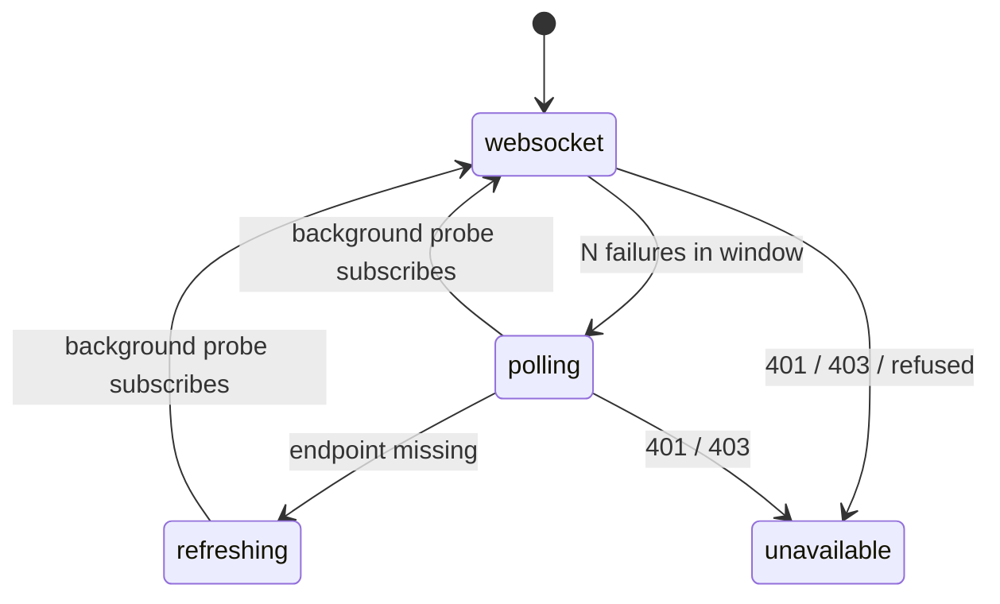

# Design

## One place for the transport

`LiveEvents` (`data/events/live_events.dart`) owns the cursor and decides the transport. It keeps the public
shape the rest of the app already uses (`updates` carrying `EventReceived` and `EventsMissed`), so `refreshOn`
and `onEvents` do not change. `TixEventStream` stays the WebSocket client and gains a starting cursor.

`offline` and `connecting` are what the indicator shows while a transport retries: offline when the last error
was a network failure, connecting otherwise.

## Defaults

| Setting | Default |
| --- | --- |
| Failures before falling back | 3 |
| Window they count in | 2 minutes |
| WebSocket retries | 1 s doubling to 60 s, 20% jitter (unchanged) |
| Background WebSocket probe while polling | every 2 to 5 minutes (2 min plus up to 150% jitter) |
| Long-poll `wait` | 25 s |
| Poll backoff on errors | 1 s doubling to 60 s, 20% jitter |
| Periodic refresh without the endpoint | every 45 s |

All of them live in `LiveConfig`, overridable through `liveConfigProvider`.

## Cursor handover

LiveEvents de-duplicates on its own cursor, whichever transport an event came from. Going to polling, the poll
starts at the last `seq` delivered. Going back, the probe subscribes with the cursor as it was when the probe
started; polling continues until the probe is acknowledged, and anything both deliver is dropped by `seq`.
`next_seq` is the highest seq the server examined (tix's `event-poll` design), so the cursor moves past events a
filter skipped. A handover with no cursor (nothing ever received) reports a gap, as a reconnect without a cursor
already does.

## Failures

Every failed connect or abnormal close counts, network failures included: a proxy that resets the TCP
connection looks like a network failure from here. When polling then fails the same way the indicator says
Offline and polling backs off; the first poll that succeeds after that probes the WebSocket at once, so a
network blip does not leave the app polling for minutes.

A probe refused with 401 or 403 while polling works is a broken WebSocket path, not a refused credential: the
poll has the same scope rules. Only the main transport makes the stream unavailable.

## Without the endpoint

404 or 405 on the poll means an older server. Periodic refresh emits `EventsMissed` on a timer, which every
provider that called `refreshOn` already treats as "read again". Those are the providers alive, i.e. what is on
screen, so nothing else needs to know about the mode. The cursor is dropped in this mode, and coming back to the
WebSocket reports a gap.

## Background

Phones (`Platform.isAndroid || Platform.isIOS`, the platform-service check AGENTS.md allows) pause the poll, the
refresh timer and the probe when the app is paused, cancelling the request in flight. Resume polls from the
cursor at once, so nothing is missed. Desktops keep running.

## Connectivity

No connectivity plugin: it adds native code on every platform to tell us what the next failure tells us anyway.
Coming back to the foreground already retries at once.
